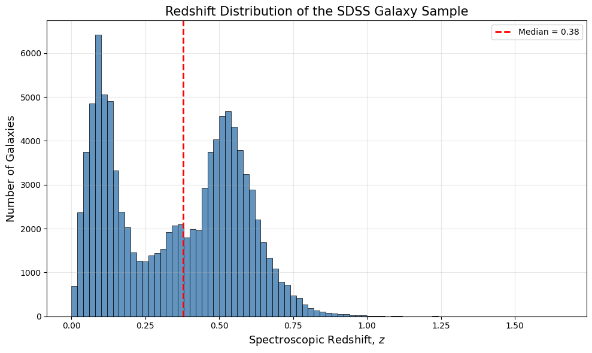
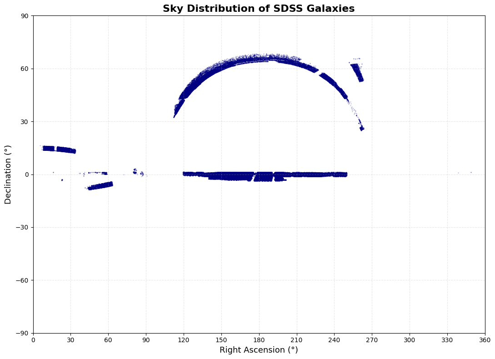
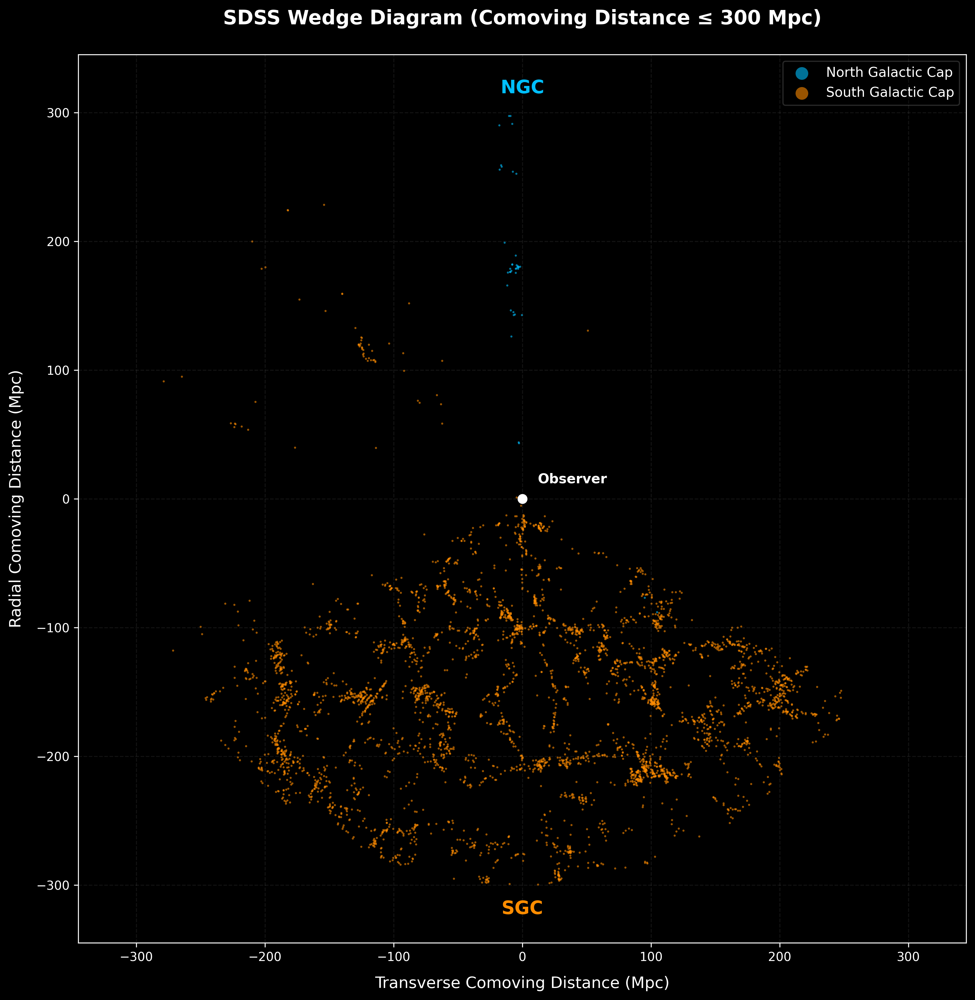
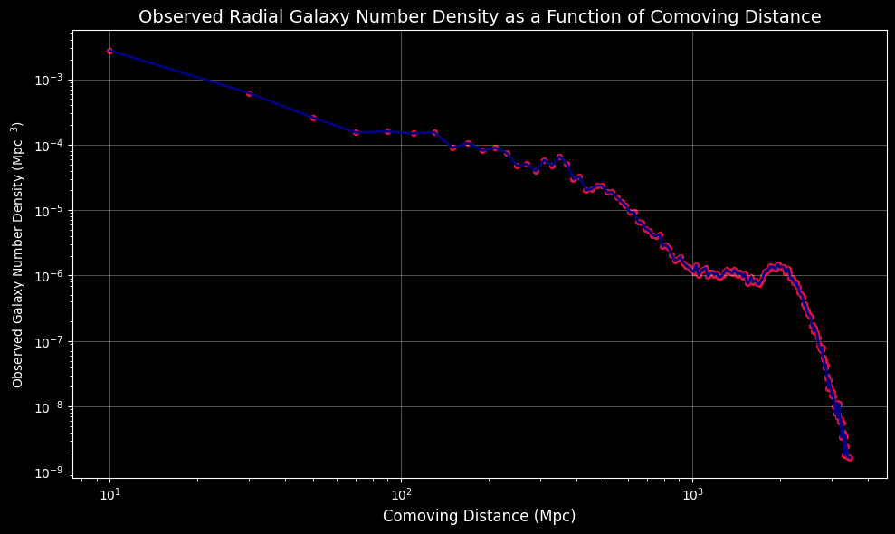

# Mapping the Cosmic Web: Large-Scale Structure of SDSS Galaxies

[

Reconstruction of the large-scale structure of the Universe from ~100,000 SDSS spectroscopic
galaxies: from raw (RA, Dec, z) to comoving coordinates, exploratory analysis of the survey
geometry and selection effects, and a smoothed 3D overdensity field with marching-cubes
isosurfaces tracing the cosmic web.

Author: Shashwat Srivastava (astroshashwatsri [at] gmail [dot] com)

## Pipeline

1. **Data**: SDSS DR18 SkyServer SQL query (galaxies with `zWarning = 0`), see [`data/README.md`](data/README.md).
2. **Cleaning**: range checks on RA, Dec, z; missing-value and duplicate checks.
3. **Distances**: comoving distance with `astropy` `FlatLambdaCDM` (H0 = 68.17, Om0 = 0.3027), then spherical to Cartesian coordinates.
4. **EDA**: redshift and distance histograms, D_c vs z, RA-Dec sky map, wedge diagrams, radial number density.
5. **Density field**: voxelisation (15 Mpc cells) -> overdensity delta = (rho - rho_mean) / rho_mean -> Gaussian smoothing (sigma = 1 voxel).
6. **Cosmic web**: isosurface at delta = 0.5 via marching cubes (`scikit-image`), shown interactively with Plotly.

## Selected results

| | |
|---|---|
|  |  |
| Bimodal redshift distribution (Legacy vs BOSS/eBOSS targets) | Survey footprint (NGC, SGC, equatorial stripe) |
|  |  |
| Wedge diagram in thin Dec slices | Observed radial number density |

The apparent sheet/wedge geometry in the 3D views reflects the SDSS footprint and selection
function, not physical structure. The isosurfaces are qualitative visualisations of the observed
galaxy density, not corrected matter density.

## Run it

**Colab:** click the badge above and upload `SDSS_data_galaxies.csv` when prompted.

**Locally:**
```bash
git clone https://github.com/astro-shashwat/Mapping-the-Cosmic-Web-A-LSS-Analysis-of-SDSS-Galaxies.git
cd Mapping-the-Cosmic-Web-A-LSS-Analysis-of-SDSS-Galaxies
python -m venv .venv && source .venv/bin/activate
pip install -r requirements.txt
# put SDSS_data_galaxies.csv in data/ (see data/README.md), then
jupyter lab notebooks/cosmic_web_sdss.ipynb
```
The first code cell uses `google.colab.files.upload()`; replace it with
`df = pd.read_csv("../data/SDSS_data_galaxies.csv")` when running locally.
The 15 Mpc voxel grid was chosen to fit Colab's RAM limit.

## Repository layout

```
notebooks/   analysis notebook (large Plotly output stripped)
figures/     static plots used in this README
data/        data instructions (CSV not tracked)
```

## Limitations and future work

- Galaxy density is not corrected for the survey selection function or completeness mask.
- Single smoothing scale and single threshold; no cosmic-web classification (DisPerSE, NEXUS) yet.
- Planned: DESI DR1 / larger surveys, multi-scale smoothing, Minkowski functionals.

## References

- York et al. (2000), AJ 120, 1579, SDSS technical summary
- Hogg (1999), arXiv:astro-ph/9905116, distance measures in cosmology
- Astropy Collaboration (2022), ApJ 935, 167
- Lorensen & Cline (1987), Marching Cubes, ACM SIGGRAPH 21, 163
- Virtanen et al. (2020), Nature Methods 17, 261, SciPy

## License

MIT, see [`LICENSE`](LICENSE). SDSS data are subject to SDSS data-use and citation policies.
